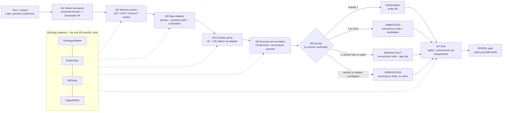

# Anonymous-node grounding — architecture and methodology (v1.1, 2026-10-16)

Draft for agreement with Tsoru. v1.1 adds three pre-meeting probes (findings 11–14). It builds on the evidence collected from 9 to 16 Oct (§2) and refines Part III of `PROJECT_CONTEXT.md`. Where the two differ, this file is newer.

---

## 1. The problem in one paragraph

A sentence often states a fact about an entity it never names: *"His namesake nephew was a notable architect."* Today's extractors either drop the fact (NEF 2.0's STRICT mode) or guess a name (LLMs). We **turn the description into a query against a knowledge base** and then:
- name the entity **only when the KB returns exactly one answer**;
- otherwise keep the fact with an **anonymous node**:
  - carrying the candidate set when the KB is ambiguous, or
  - flagged as a **missing fact** when the KB records nothing.

The same machinery must work on **any ontology** through thin adapters. We show it on DBpedia and Wikidata.

**Definitions used throughout**
- **Unnamed mention:** a reference to an entity that is not its name, an alias, or a pronoun for a named entity.
- **Relational description:** an unnamed mention that picks the entity out *through a relation to another entity* (the **anchor**): "Marie Antoinette's husband", "his namesake nephew", "the band's drummer", "the founder of Mérida".
- **Topic reference:** an unnamed mention of the text's own subject ("He…", "The film…"). This is coreference, already handled by NEF's coref tiers, and **out of scope** for the core claim (§2, finding 1).

---

## 2. What the evidence says, and what each finding forces

| # | Finding (source) | Design consequence |
|---|---|---|
| 1 | 43% of abstract sentences contain an unnamed reference, but 40% are the topic itself (`occurrence/`) | Scope = non-topic entities. Topic references stay with coref. |
| 2 | Relational descriptions of other entities: **2.7%** of sentences (CI 1.4–5.2%); KB-groundable ~0.2–1% (`occurrence/`, first pass, κ pending) | The phenomenon is real but sparse. **The test set must be built deliberately** (controlled + mined, §6), not sampled at random. The text source must be widened beyond abstracts. |
| 3 | Relations are mostly unique once nested values are collapsed: DBpedia 77%, Wikidata 87% (volume-weighted) (`results/`, `wikidata/`) | The uniqueness rule is viable as a decision criterion. |
| 4 | **Coverage is the bottleneck**: on the same 2,271 facts, Wikidata grounds 47–49% vs DBpedia 19–21% (`wikidata/`) | Wikidata is the primary KB; DBpedia is the second adapter. Missing facts are a first-class outcome, not an error. |
| 5 | When the KB answers, it agrees with the text **~96% (WD) / ~98% (DBP)** once granularity and modelling conventions are handled. Raw exact-ID agreement looked like 58% / 84% (`wikidata/results/disagreement_coding.json`) | The decision layer needs a **convention-aware comparator**: containment, demonym ↔ country, historical polity, subclass, player ↔ sport. Without it, a correct grounding is scored as wrong. |
| 6 | Father/mother 99.6% unique vs "parent" 51%; team and child are many-valued in Wikidata | Descriptions must be **decomposed with constraints** (gender, ordinal, time): "husband" = spouse ∧ male; "eldest son" = child ∧ male ∧ ordinal. Wikidata qualifiers (P1545 series ordinal, P580/P582 start/end time) carry ordinals and time. |
| 7 | Natural cases are often **nested**: "the grandson of the founder of Mérida", "a granddaughter of the fourth head of Yonezawa" (`occurrence/scan_verified.py`) | The intermediate representation is a **path** of relations, not a single property, and anchors can themselves be descriptions. |
| 8 | Implicit entity linking (Perera 2016; Hosseini 2019–22) links unnamed *topic* entities in tweets by ranking. The type must be known in advance, every item yields a top-1 answer, and nothing abstains (`related_work.md`) | Our differences are relation-constrained grounding, cardinality-based abstention, anonymous-node output inside extraction, and cross-ontology adapters. An **implicit-EL-style ranker is a required baseline.** |
| 9 | Annotated corpora drop referents with no unique KB ID (OpenEL 2022) | Motivation: we keep exactly what others discard. |
| 10 | About 1 in 4 of the residual mismatches came from our own Phase-1 extraction or name→ID mapping | Error analysis must separate pipeline noise from grounding errors. The test set gives gold anchors for the controlled condition. |
| 11 | **Open world: schema-unique beats data-unique.** Wikidata declares a single(-best)-value constraint on only 5 of 57 mapped properties (P19, P20, P22, P25, P36). Like-for-like (place relations): KB answer agrees with the text **90.1%** when the relation is schema-unique vs **78.4%** when only data-unique (exact + containment, before conventions; CIs 82.7–94.5 vs 73.6–82.5). Schema-unique relations are unique in 99.0% of covered facts. DBpedia declares 31 functional properties, none of them object relations we use (`wikidata/schema_uniqueness.py`) | M6 records a **grounding tier**: *schema-unique* (strong) vs *data-unique* (weaker). All metrics are reported per tier; an optional strict mode grounds schema-unique only. This is the formal answer to "unique in the KB ≠ unique in the world". |
| 12 | **Density probe** (50 people, same people on both sides): relational descriptions per 100 sentences are about the same in full article bodies (1.6 non-fiction, CI 1.1–2.4) as in abstracts (2.9, CI 1.2–7.3), but bodies give **≈ 6× more cases per person** (0.50 vs 0.08) (`occurrence/density_*.py`) | The natural set is mined from full biography articles: ~600–900 articles → 200–300 items. Fiction articles (soap, film plots) are filtered out. Changing the source does not raise per-sentence density, so G2 is argued on yield, not density. |
| 13 | **25–31% of real descriptions are named elsewhere in the same text** (abstract, lead or body), and some are inferable from a neighbouring sentence ("a brother of the wife of Guilhem" → "his brother-in-law" = Guilhem) | New step **M2b in-document resolution before the KB**: if the text itself resolves the description, use it and let the KB *verify* it. Named-elsewhere cases are also free silver gold for evaluating grounding. |
| 14 | **Headroom teaser** (23 real descriptions, oracle parse, local LLMs told they may say UNKNOWN): Wikidata grounds 7, finds nothing for 15 (missing fact), 1 anchor not in the KB. **Neither Qwen2.5-7B nor Llama-3.1-8B named a wrong entity**: they abstain (16/23, 13/23) or answer from the text. The KB alone named 2 long-tail entities both LLMs could not (Arthur Winter's brother William Winter; Uesugi Harunori's father 秋月種美, who has only a Japanese label). Llama named 2 plausible entities the KB lacks (`occurrence/headroom_*.py`) | The story is **not** "LLMs hallucinate names" when abstention is invited. The value is (a) long-tail recall where the KB knows and the LLM doesn't, and (b) **keeping the ~65% of facts nobody can name** as anonymous nodes + missing-fact flags instead of losing them. B1 must also run in **extraction mode** (abstention not invited), where hallucination is still untested. n = 23: a signal, not a result. |
| 15 | **Extraction mode** (same 23, prompt: "extract triples with canonical entity names", no UNKNOWN option): the unnamed entity ends up as a **junk phrase node** ("brother_of_Arthur_Henry_Winter", "wife", "a daimyo of the Akizuki clan") 10/23 for both models, **flattened** into an attribute of the anchor ("fatherOccupation: lawyer") 5/4, or **dropped** 2/2 → **74% (Qwen) / 70% (Llama) lost or junk**. Wrong identity only once (Qwen: mother = "the fourth head of Yonezawa"). Of the 7 KB-groundable items, each model fails 3 (`occurrence/extraction_mode.py`, `extraction_graded.py`) | The core failure of LLM extractors here is **junk and lost entities, not invented names**. Our output turns each into a grounded entity or a well-formed anonymous node (oracle parse: 7 grounded, 15 missing-fact nodes, 1 unresolved, 0 junk, 0 dropped). New metric: **junk-node rate** (description strings emitted as entities). Caveat: our side used an oracle parse; the real M1 must earn it. |

---

## 3. Architecture

### 3.1 Overview



It slots into NEF 2.0 exactly where STRICT mode drops non-entity subjects and objects today. Everything outside the adapters is KB-neutral.

### 3.2 The Description IR (intermediate representation)

One JSON object per unnamed mention. M1 produces it; M2 and M3 fill it in; M4 compiles it.

```json
{
  "mention": "his namesake nephew",
  "role": "subject",
  "anchor": {"ref": "topic", "text": "Carlo Zucchi", "id": null},
  "path": [{"phrase": "nephew", "hops": [{"prop": null, "dir": "out"}]}],
  "constraints": {"gender": "male", "ordinal": null, "time": null,
                  "type": "Person", "same_name_as_anchor": true,
                  "plural": false, "count": null},
  "evidence": {"sentence_id": "00964", "span": [0, 19]}
}
```

- **`anchor.ref`** is `topic`, `mention` (a named entity in the text), or `description` (nested; it holds another IR).
- **`path`** is a chain. Relational nouns expand to KB-neutral hops through a **relation lexicon** owned by the adapter:
  - *nephew* = sibling → child, + male
  - *grandson* = child → child, + male
  - *husband* = spouse + male
  - *founder of X* = inverse(founded by)
- **`constraints`** become filters. Each adapter knows how to express them: Wikidata gender = P21; DBpedia gender = foaf:gender; ordinal = P1545 qualifier; time = P580/P582.

### 3.3 Modules

| Module | Does | How | Reuses from NEF 2.0 |
|---|---|---|---|
| **M1 Detect & parse** | Finds unnamed non-topic mentions and fills the IR (mention, anchor text, relation phrases, constraints) | LLM with structured output (Qwen2.5-7B locally; API models as baselines), plus the high-recall pattern scanner from `occurrence/scan.py` as a recall net | Node 1 prompt, which currently emits flat strings |
| **M2 Resolve anchor** | Gives the anchor an ID | Topic → the abstract's entity; named → surface-form index + NEF linker; nested → recurse M2–M6 on the inner description, continuing only if that one is GROUNDED | Nodes 2–3, Redis `sf:` index, coref tiers |
| **M2b In-document resolution** | Checks whether the text itself names the referent (apposition elsewhere, a neighbouring sentence, bridging) | Document-level coreference/bridging over the article; if resolved, the KB step **verifies** the text's answer instead of choosing one (finding 13) | coref tiers |
| **M3 Map relations** | Phrase → property path + direction + constraints, with a confidence score | Adapter's relation lexicon (kinship and role tables) → property label/alias retrieval (embeddings) → LLM re-rank of the top-k. Below threshold → UNRESOLVED | Node 3 predicate linker, predicate filter |
| **M4 Compile** | IR → executable query | KB-neutral conjunctive path query → the adapter renders SPARQL (WD: `wdt:`, or `p:/ps:/pq:` when qualifiers are needed; DBP: `dbo:`) | — |
| **M5 Execute & normalise** | Gets the answer set and collapses equivalents | Merge values that contain one another (adapter's containment properties); **convention rules** (demonym → country, historical polity → successor, subclass via P279/`rdfs:subClassOf`, sport ↔ player); merge sameAs and redirects; filter by type and gender | Containment logic from the surveys; `decompose_mismatches.py` caching |
| **M6 Decide** | Picks the outcome by cardinality after normalisation, and records the **grounding tier** (schema-unique / data-unique, finding 11) | 1 → GROUNDED; ≥2 → AMBIGUOUS (keep candidates; optional ranking reported separately, never auto-picked); 0 with the relation known for the anchor's type → MISSING FACT; anchor or relation unmapped → UNRESOLVED | SPARQL gate thresholds |
| **M7 Emit** | Writes the facts | `OutputWriter` per adapter (§3.5) | Output harness |

### 3.4 Adapter interfaces (the ontology-agnostic layer)

```text
OntologyAdapter   properties(), label/aliases(prop), domain/range(prop), inverse(prop),
                  relation_lexicon(), containment_props(), constraint_filter(kind, value),
                  convention_rules(), class_hierarchy(cls)
EntityIndex       lookup(mention, k) -> [(id, score)], popularity(id)
KBQuery           values(anchor, path, constraints) -> set[id], has_any(anchor, prop) -> bool,
                  ancestors(id, props) [cached], types(id)
OutputWriter      grounded(s, p, o, prov), anonymous(node, desc, candidates|gap, prov)
```

- **DBpedia adapter** = a pure refactor of NEF 2.0, with zero behaviour change. Gate G5: three domains reproduce `results/final_clean` within ±0.02.
- **Wikidata adapter** (primary):
  - index from labels and aliases, starting with what the test set needs;
  - queries through QLever / WDQS. Bound-subject transitive queries only — VALUES on both ends times out (learned 16 Oct). Every response is cached.
- **Third adapter, optional, for RQ3:** YAGO 4.5 (schema.org classes over Wikidata entities) would show that a schema.org-typed KB plugs in. To verify availability and endpoint before committing.
- **Generality is measured, not claimed:** count lines of code and config per adapter, and core-code changes needed per new KB (target: zero).

### 3.5 Output representation (decision needed with Tsoru)

Proposal:
- **Skolem IRIs** (`…/.well-known/genid/…`), not plain blank nodes. They are stable across updates, which is the reason Wikidata itself moved to them.
- Each anonymous node carries:
  - `rdf:type` (from the path's range or the constraints);
  - `nef:describedAs` (the mention text);
  - `nef:anchor` and `nef:path` (the IR);
  - `nef:status` ∈ {ambiguous, missing-fact, unresolved};
  - `nef:candidate` (for ambiguous).
- Provenance for every fact (extracted / kb-grounded / anonymous), via **RDF-star** or named graphs.
- The Wikidata writer emits *somevalue* (PropertySomeValueSnak), Wikidata's native "a value exists but is unknown".
- Later work, not in v1: merging anonymous nodes across a corpus when they describe the same entity.

### 3.6 Worked example (real data)

*"Marie Antoinette's husband was guillotined in 1793."*
- **M1:** IR with anchor = "Marie Antoinette", path = [spouse], constraint gender = male.
- **M2:** anchor → Q47365.
- **M3:** spouse → P26.
- **M4–M5:** Wikidata returns **two** truthy P26 values: Louis XVI and Axel von Fersen the Younger (found in our 16 Oct smoke test). Both are male.
- **M6:** AMBIGUOUS → anonymous node with 2 candidates. An LLM confidently says "Louis XVI", which is right here, but **the KB as published does not license that answer**.

This is exactly where cardinality-based abstention and an LLM differ. It also shows the result depends on the KB snapshot, so snapshots are pinned (§8).

---

## 4. Approaches compared (Tsoru: "build several approaches")

| ID | System | KB use | Abstains? | Why it's there |
|---|---|---|---|---|
| B0 | NEF 2.0 as-is (STRICT) | links named entities only | drops the fact | the gap being closed |
| B1 | LLM, closed book | none | if told it may say "unknown" | the default today; memorisation |
| B2 | **Implicit-EL ranker** (Perera/Hosseini style) | anchor + KB neighbours of the inferred type, ranked | no, always top-1 | closest prior work; shows what abstention buys |
| B3 | **LLM + KB tool** (LLM writes SPARQL, runs it, answers) | LLM-generated query | if the LLM chooses | the strongest baseline — "KBQA inside extraction" |
| B4 | LLM + retrieved KB neighbourhood (RAG) | anchor's KB facts as context | if the LLM chooses | cheaper middle ground |
| **N** | **Ours, neuro-symbolic** (§3) | compiled IR + cardinality rule | by construction | the method |
| **H** | **Ours, hybrid** | N, falling back to B3's LLM-written query when M3 confidence is low | by construction | best of both |

Models:
- Local: Qwen2.5-7B, Llama-3.1-8B (GPU permitting).
- API: GPT-4o, GPT-5.6 Luna, Claude — budget-capped, with Tsoru's OK before any spend.

The same LLM is used inside N/H as in B1/B3/B4, so the comparison isolates the method, not the model.

---

## 5. Research questions → experiments

| RQ | Question | Experiment | Main result table |
|---|---|---|---|
| RQ1 | How often can an unnamed entity be grounded uniquely; how does it depend on KB and relation? | **E1 Groundability survey.** Done on Phase-1 facts for both KBs; repeat on the natural test items; report by relation family with convention-aware comparison | Uniqueness / coverage / expected grounding / agreement, DBP vs WD, by family |
| RQ2 | Does KB-constrained grounding with abstention beat the LLM and KB-tool baselines, especially on the long tail and when nothing is recorded? (B1 in two modes: abstention invited, and plain extraction) | **E2** controlled set, all systems, stratified · **E3** natural set (realism) · **E5** ablations | Accuracy and hallucinated-identity rate by KB × answer type × popularity |
| RQ3 | Can one architecture serve different ontologies via adapters, and at what cost? | **E4** adapter generality (DBP regression G5; WD; optional YAGO) · **E6** cost | LoC/config per adapter, core changes = 0; $ / 1k sentences, calls, latency |

**Ablations (E5, on dev only):**
- no containment collapse;
- no convention rules;
- no gender/ordinal constraints;
- no abstention (take the first answer);
- forward-only path direction;
- no nested recursion;
- B3-style query only (= H without N).

**E7 Error analysis**, over every wrong output: detection miss · wrong anchor · wrong property · KB coverage gap · genuine ambiguity · convention mismatch · pipeline (extraction) noise · emission. Plus 5–6 case studies, including one where the LLM beats us (a famous entity whose fact the KB lacks).

---

## 6. Test set

Two parts, because natural cases are sparse (finding 2):

### 6.1 Controlled set (statistical power)

- **Built from KB facts.**
  1. Take an anchor and a relation, then write a sentence that describes the target instead of naming it. Description patterns: possessive, relational, appositive, role ("the band's drummer"), nested (2 hops).
  2. **The KB decides the answer type, not the sentence:**
     - unique → gold entity;
     - several → gold candidate set;
     - none (the anchor lacks the relation) → `ABSTAIN` (missing fact).
  3. No-answer items are created deliberately.
- **Strata:** 2 KBs × 3 answer types × 3 popularity tiers (DBP in-degree, WD sitelinks) = 18 cells × ~50 items ≈ **900 items**. That gives about ±7 points per cell and ±3 overall. Plus a nested-description slice (~100).
- **Generation:** templates → LLM paraphrase → **every item checked by a human**.
- **Leakage control:** the popularity tiers expose memorisation; report every number by tier.

### 6.2 Natural set (realism)

- **Mined, not generated:**
  1. run the M1 scanner and an LLM detector over Wikipedia text — abstracts **and full article bodies** (to test finding 2's prediction of higher density), biographies first;
  2. verify every hit by hand;
  3. gold-label each with both KBs.
- **Target:** 200–300 items. Report the occurrence rate per source with CIs.
- This is where end-to-end extraction F1 is measured.

### 6.3 External benchmarks

From the benchmark survey, no existing benchmark contains relational descriptions of non-topic entities (0/120 hand-labelled).
- Text2KGBench `wikidata_tekgen` is used for a **no-harm check**: end-to-end triple F1 must not drop when the module is on.
- The CoNLL / Wikidata sets Tsoru named are to be identified with him, then adapted if they fit.

### 6.4 Annotation quality

- Written guidelines (`occurrence/GUIDELINES.md` → `testset/GUIDELINES.md`).
- 15% double-annotated → Cohen's κ.
- Second annotators: Nakul, Tsoru / Ara / Aaquifa.
- **The test set is frozen and hashed before any approach is tuned** (G3). Dev = 20%.

---

## 7. Metrics

**Per item, by gold answer type:**

| Gold type | Correct behaviour | Metrics |
|---|---|---|
| unique | name the gold entity | grounding accuracy; wrong-ID rate; over-abstention rate |
| ambiguous | anonymous node + candidates ⊇ gold set | candidate recall, set size; false-grounding rate (picked one) |
| none (KB lacks it) | anonymous node + missing-fact | abstention precision and recall |

**Headline numbers** (after finding 14, lead with what is *kept and recovered*, not only what is avoided):
- **Junk-node rate:** description strings emitted as if they were entities ("wife_of_George_Hyde"), and facts flattened into attributes of the anchor (finding 15).
- **Facts kept:** the share of descriptions whose fact survives into the KG output (grounded, or as an anonymous node with candidates or a missing-fact flag), vs dropped by B0 and lost to UNKNOWN by LLMs.
- **Long-tail recall:** grounding accuracy on the bottom popularity tier.
- **Per grounding tier:** accuracy for schema-unique vs data-unique groundings.
- **Hallucinated-identity rate:** the share of items where the system names an entity the evidence doesn't license.
- **Grounding F1 on answerable items.**
- **Risk–coverage curve** (selective prediction): accuracy vs share answered. This compares our hard abstention with LLM confidence thresholds fairly.

**End-to-end (natural set):** triple F1. An anonymous-node triple matches gold when the anchor, path and status match.

**Cost:** $ per 1,000 sentences, LLM calls per item, latency, local vs API.

**Rigour:**
- 3 runs per LLM system;
- bootstrap 95% CIs;
- paired tests (McNemar) for the main comparisons;
- every number traceable to a script and a saved output.

---

## 8. Reproducibility and data hygiene

- **KB snapshots are pinned:**
  - DBpedia 2022-12 in the local oxigraph store;
  - Wikidata: record the QLever index date, and cache every query response (`ancestors_cache.json`-style) so reruns don't depend on the live service.
- **Seeds** for every sample (the surveys use seed 7 / 40 / 41 / 50).
- Code in the personal repo under `research/anonymous_nodes/`. The `v14-final` tag is never moved. The upstream `GSoC26/` code stays untouched.
- **Licences for the release:** Wikidata CC0, DBpedia CC BY-SA, Text2KGBench's own licence; datasheet for the test set.

---

## 9. Plan and gates (refines PROJECT_CONTEXT Part III)

| Phase | Dates | Output | Gate | Status (16 Oct) |
|---|---|---|---|---|
| 1 Scope & novelty | 15 Oct – 8 Nov | related work, benchmarks, contribution | **G1 novelty** | pass 2 done for implicit EL; KBQA-answerability (GrailQAbility) and bridging still to read |
| 2 Feasibility | 9 – 29 Nov | WD survey, occurrence, conventions | **G2 feasibility** | mostly done early. Grounding ≥30% on WD ✔; occurrence 2.7% vs the ≥3% bar → **borderline**, so add the full-article source (§6.2) |
| 3 Test set | 30 Nov – 10 Jan | controlled ~900 + natural 200–300, guidelines, κ | **G3 freeze** | guidelines v1.1 exist |
| 4 Baselines | 11 – 31 Jan | B0–B4 on dev + test, stratified, cost | **G4 headroom** | — |
| 5 Adapters | 14 Dec – 31 Jan | DBP refactor (regression), WD adapter, IR + writer | **G5 regression** | QLever query patterns learned |
| 6 Approaches | 1 Feb – 7 Mar | N, H, ablations on dev | — | — |
| 7 Evaluation | 8 Mar – 4 Apr | all tables with CIs, error taxonomy, cost | **G6 claims** | — |
| 8 Writing | 22 Mar – ISWC deadline (~early May) | paper, code + data release | submit | — |

**Fallback ladder (unchanged):**
1. ISWC research track.
2. ISWC Resources track (test set + generic framework).
3. KGSWC or an ESWC workshop.
4. A workshop paper on the NEF 2.0 results.

---

## 10. Risks specific to this design

| Risk | Mitigation |
|---|---|
| Natural cases too sparse to evaluate end-to-end | Controlled set carries the statistics; natural set reports realism; full article bodies as a denser source |
| LLM + KB tool (B3) already abstains well | Then lead with cost, generality and nested descriptions (B3 must write multi-hop queries) |
| Convention rules turn into a hand-made mess per KB | Keep them as data in the adapter; report how many rules each KB needed (it's part of RQ3) |
| KB errors (Fersen as a spouse) make "unique" wrong | Report KB-error cases separately; the gold set marks them; the paper frames grounding as "licensed by the KB", not "true" |
| QLever limits or outages | Bound-subject queries, caching, pinned snapshot |
| One annotator | κ on 15% with a second person; the blind 50 is the first check |

---

## 10b. Probes run before the meeting (16 Oct)

- `wikidata/schema_uniqueness.py` → `wikidata/results/schema_uniqueness.json` (finding 11).
- `occurrence/density_probe.py`, `density_verified.py` → `occurrence/results/density_summary.json` (findings 12–13).
- `occurrence/headroom_teaser.py`, `headroom_graded.py` → `occurrence/results/headroom_summary.json` (finding 14).
- `occurrence/extraction_mode.py`, `extraction_graded.py` → `occurrence/results/extraction_summary.json` (finding 15).
- All hand judgements in these are Claude's, one pass.

## 11. Decisions needed from Tsoru

1. **Scope:** non-topic relational descriptions only — topic coreference out. Agree?
2. **Primary KB = Wikidata**, DBpedia second, YAGO 4.5 as an optional third. Agree?
3. **Representation:** skolem IRIs + RDF-star provenance, Wikidata *somevalue* in the WD writer?
4. **Text sources** for the natural set: abstracts + full article bodies (biographies first)?
5. **Which CoNLL / Wikidata benchmarks** he meant (§6.3).
6. **API budget** for the B1/B3/B4 baselines.
7. **G2 thresholds**, given 2.7% occurrence: accept with the source widened, or change the story's weighting toward controlled evaluation? (Full articles give ≈6× more cases per person at the same density.)
8. **Story emphasis** after the headroom teaser: lead with *facts kept + long-tail recall + abstention by schema tier*, rather than "LLMs hallucinate"?
